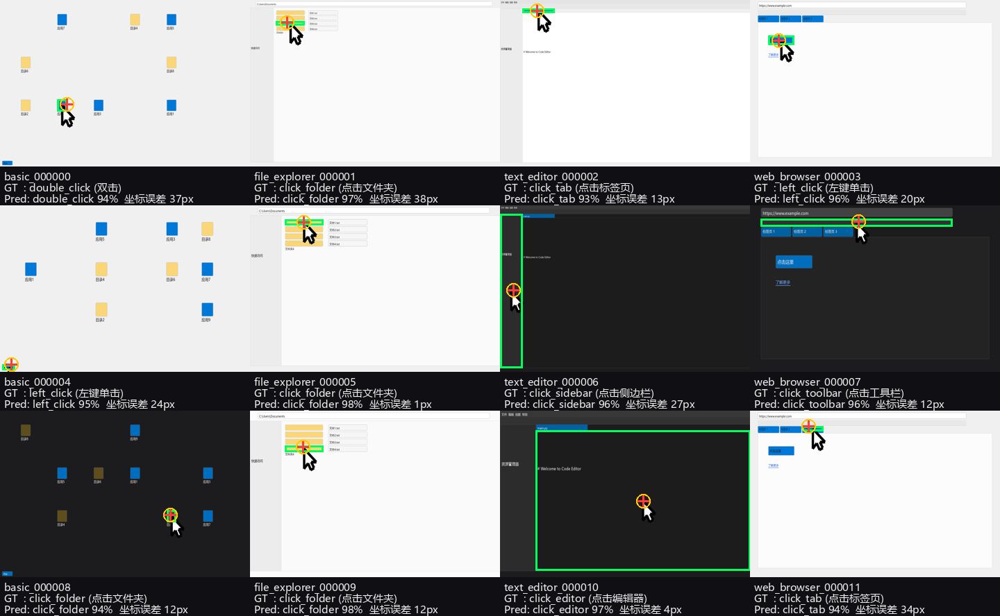

# AI智能桌面操作员

AI智能桌面操作员是一个基于深度学习和大语言模型的智能桌面自动化系统：用 DeepSeek 做自然语言任务理解，
用 CNN 分析屏幕内容并预测"该在哪、做什么操作"，再由自动化控制器执行鼠标/键盘动作。

---

## ⚠️ 请先处理：API 密钥已经泄露

`.env` 文件**曾被 git 跟踪**并推送到 GitHub（`origin/improve-training-and-automation`、`origin/backup-before-filter`，
涉及提交 `1f7f48d`）。其中的 `DEEPSEEK_API_KEY` 属于公开可读状态。

已完成的处理：

- ✅ `git rm --cached .env` —— 文件已移出版本控制，本地 `.env` 原样保留，`.gitignore` 持续生效
- ✅ 全历史扫描确认：**只有 `.env` 一个文件、只有 `1f7f48d` 一个提交**含该密钥，
  `config.py` 从未硬编码过密钥（它一直是 `os.getenv`）

**仍需你人工完成的两步：**

1. **到 <https://platform.deepseek.com> 吊销并轮换这个密钥。**
   这是唯一真正有效的补救——重写 git 历史**撤不回已经发生的泄露**
   （GitHub 的缓存、fork、以及任何克隆过仓库的人手里都还有旧密钥）。
2. **重写历史并强推**（可选，但建议做，防止旧密钥继续散播）：

   ```powershell
   pwsh scripts/purge_env_from_git_history.ps1            # 演练，只打印将执行的命令
   pwsh scripts/purge_env_from_git_history.ps1 -Execute   # 真正执行（自动打备份标签）
   ```

   脚本会剔除所有提交里的 `.env`、清理 `refs/original` 与 reflog、并再次扫描确认
   历史中已匹配不到 `sk-` 密钥。注意重写历史会改变所有提交 SHA，协作者需要重新 clone。

---

## 功能特性

- **智能任务理解**：使用 DeepSeek API 进行自然语言理解和任务分解
- **屏幕分析**：EnhancedCNN（ResNet50 主干 + 多任务头）分析屏幕内容，预测操作类型与点击坐标
- **空间定位**：soft-argmax 坐标头，在 test 集上平均误差 **20 px**（详见[实测结果](#实测结果)）
- **自动化操作**：支持鼠标点击、双击、右键、滚轮、键盘输入等自动化操作
- **工作流支持**：提供复杂任务的自动化工作流（如文档写作）
- **图形界面**：基于 PyQt6 的交互界面

## 项目结构

```
ai_operator/
├── core/                    # 配置
├── agents/                  # DeepSeek 智能体
├── data/
│   ├── data_processor.py
│   └── desktop_dataset.py   # ★ 数据集加载器（标注解析 / ImageNet 归一化 / 光标注入）
├── data_generation/         # ★ 数据集生成器
│   └── dataset_creator.py   #   已修复：空白截图 / 动作因果性 / 光标烘烤
├── models/
│   ├── cnn_model.py         # ★ EnhancedCNN：空间 soft-argmax 坐标头 + 多任务头
│   └── training_pipeline.py # 通用训练流水线（JSON 数据集）
├── automation/              # 鼠标 / 键盘 / Web / 工作流
├── ui/                      # PyQt6 界面
└── main.py                  # 主入口

scripts/
├── build_dataset_v2.py      # ★ 生成因果修正数据集 v2（推荐路径）
├── build_dataset_from_creator.py  # ★ 用已修复的生成器产出数据集 v3 + 因果性审计
├── train_ai_operator.py     # ★ 真正可用的训练脚本
├── demo_desktop_agent.py    # ★ 演示脚本（eval / image / live 三种模式）
├── repair_screenshots.py    # ★ 修复 v1 数据集里的空白截图
├── purge_env_from_git_history.ps1  # ★ 从 git 历史中清除 .env
├── train_example.py         # 合成数据冒烟训练
├── infer_example.py         # 单张推理示例
└── export_onnx.py           # 导出 ONNX

tests/
└── test_desktop_pipeline.py # ★ 23 项单测（含生成器因果性与坐标头回归测试）
```

## 安装

```bash
.venv\Scripts\python.exe -m pip install -r requirements.txt
```

当前 `.venv` 内已装好 PyTorch 2.9.1（**CPU 版**）、torchvision、onnxruntime、PyQt6、scikit-learn 等。
ResNet50 的 ImageNet 预训练权重已缓存在 `~/.cache/torch/hub/checkpoints`，离线也能训练。

> 若想用本机的 RTX 3050 Ti 加速，可换成 CUDA 版 PyTorch：
> `pip install torch torchvision --index-url https://download.pytorch.org/whl/cu121`
> （约 2.5 GB 下载；CPU 版训练 349 张图约 50 秒/轮，其实已经够用。）

## 配置 API 密钥

```powershell
$env:DEEPSEEK_API_KEY = "your_api_key_here"      # 当前会话
setx DEEPSEEK_API_KEY "your_api_key_here"        # 永久
```

不要把密钥写进代码或提交 `.env`（见文首警告）。

---

## 快速开始：训练 + 演示

项目里有**两代数据集**，推荐直接看 v2：

| | v1（`ai_operator_dataset/`） | **v2（`ai_operator_dataset_v2/`）** |
|---|---|---|
| 动作标签 | 与目标元素**独立随机**，无因果 | 由目标元素类型**唯一决定** |
| 光标 | 截图里没有，需运行时注入 | 已**烘烤**进截图 |
| 可达到的准确率 | 动作 ≈33%（天花板，见下文） | **动作 100%，坐标 20 px** |

### 路线 A（推荐）：用 v2 数据集，一次跑出好结果

```powershell
# 第 1 步 生成 v2 数据集（固定 seed，可重复；约 20 秒）
.venv\Scripts\python.exe scripts\build_dataset_v2.py --out ai_operator_dataset_v2 `
    --train 560 --val 120 --test 120

# 第 2 步 训练（必须加 --spatial-coord，见下文"空间坐标头"）
.venv\Scripts\python.exe scripts\train_ai_operator.py `
    --data-root ai_operator_dataset_v2 --out-dir models\desktop_v2 `
    --spatial-coord --epochs 16 --batch-size 16 --patience 5

# 第 3 步 演示评估
.venv\Scripts\python.exe scripts\demo_desktop_agent.py --mode eval --split test `
    --model models\desktop_v2\best_model.pth --label-map models\desktop_v2\label_map.json `
    --data-root ai_operator_dataset_v2 --grid 12 --report-dir reports\v2
```

> v2 截图里已经画好光标，**评估时不要加 `--draw-cursor`**（会重复画一个）。

### 路线 B：修复并使用 v1 数据集

```powershell
# 一次性修复 249 张纯色空白截图（只改图，不动标注，原图自动备份）
.venv\Scripts\python.exe scripts\repair_screenshots.py --dry-run
.venv\Scripts\python.exe scripts\repair_screenshots.py

# v1 截图里没有光标，需要运行时注入才谈得上坐标回归
.venv\Scripts\python.exe scripts\train_ai_operator.py --draw-cursor --spatial-coord `
    --epochs 20 --out-dir models\desktop_cursor_v1
.venv\Scripts\python.exe scripts\demo_desktop_agent.py --mode eval --split test `
    --model models\desktop_cursor_v1\best_model.pth --label-map models\desktop_cursor_v1\label_map.json `
    --draw-cursor
```

### 训练脚本做的事

| 项目 | 说明 |
|---|---|
| 标签 | 动作分类 = `operation.action`；坐标回归 = `operation.target_bounds` 中心点，按**每张图自己的宽高**归一化 |
| 预处理 | 缩放到 224×224 + **ImageNet 均值方差归一化**（与预训练 ResNet 对齐；旧的 `data_processor` 只做 `/255`，会浪费预训练权重） |
| 损失 | `CrossEntropy(label_smoothing=0.1) + 1.0 × SmoothL1(坐标头输出, 目标点)` |
| 优化 | AdamW，主干 `1e-4` / 预测头 `1e-3` 分组学习率 + CosineAnnealing，梯度裁剪 5.0 |
| 加速 | 训练时跳过用不上的分割分支（省约一半算力）；截图预载进内存（`--draw-cursor` 在预载阶段画一次，训练循环零开销） |
| 产出 | `best_model.pth` / `last_model.pth` / `label_map.json` / `training_history.json` / `metrics.json` |

### 三个关键开关

- **`--spatial-coord`（重要）**：把坐标头从"全局池化 + 线性"换成 **soft-argmax 热力图**。
  旧结构下 `mouse_head` 收到的是被 ResNet `avgpool` 压成 `1×1` 的特征，
  **线性层不可能从全局描述子里恢复坐标**——实测坐标误差会卡在 200–300 px 下不去。
  打开后第 1 轮就降到 35 px，最终 11 px。
- **`--draw-cursor`**：在目标点画箭头光标。只适用于截图里**没有**光标的 v1 数据集；
  v2/v3 的光标已烘烤进图片，再加会重复画。
- **`--data-root`**：数据集根目录，用于切换 v1 / v2 / v3。

### 数据集生成器本身的修复（`ProfessionalDatasetCreator`）

除了另起炉灶的 v2，**旧的生成器路径也已修好**，因为它同样在被直接使用：

| 修复 | 原问题 | 现在 |
|---|---|---|
| `create_app_interface()` | 调用 `create_*_interface()` 后**从不绘制**，三类应用截图全是纯色空白图 | 统一绘制；有回归测试 |
| `generate_app_specific_operation()` | 先随机选动作、再独立随机选元素，两者无关 | 动作由元素类型唯一决定（`resolve_action()`） |
| `generate_random_operation()` | 图标点击在 left/double/right 间随机 | 同上 |
| `save_sample()` | 截图里没有光标，坐标不可见 | 自动把光标画到目标元素中心 |

**修复前后的实测对比**（同一份标注统计，`scripts/build_dataset_from_creator.py` 自动审计）：

| | 已发货数据集 v1 | 修复后生成的 v3 |
|---|---|---|
| 目标元素类型数 | 9 | 12 |
| **存在动作歧义的元素类型** | **9 / 9（全部）** | **0 / 12** |
| 最严重的例子 | `toolbar` → 10 种不同动作 | 每个元素类型恰好 1 种动作 |

也就是说，v1 数据集里**每一个**元素类型的动作都是不确定的——这就是"动作准确率天花板"的来源。

> 注意 `button` 这个元素类型：曾经在浏览器里映射成 `click_button`、在桌面里映射成 `left_click`，
> 这会让"动作是元素类型的纯函数"只在给定应用时成立并碎片化标签空间。
> 审计脚本报出了这个假阳性，现已统一为 `left_click`。

生成 v3 与训练：

```powershell
.venv\Scripts\python.exe scripts\build_dataset_from_creator.py `
    --out ai_operator_dataset_v3 --train 300 --val 80 --test 80
.venv\Scripts\python.exe scripts\train_ai_operator.py `
    --data-root ai_operator_dataset_v3 --out-dir models\desktop_v3 `
    --spatial-coord --epochs 12 --patience 4
.venv\Scripts\python.exe scripts\demo_desktop_agent.py --mode eval --split test `
    --model models\desktop_v3\best_model.pth --label-map models\desktop_v3\label_map.json `
    --data-root ai_operator_dataset_v3 --report-dir reports\v3
```

### 演示

```powershell
# ① 批量评估：准确率、坐标误差、混淆分析、可视化拼图、逐样本 CSV
#    （同一目录下还有 demo_grid_test.png / demo_metrics_test.json）
.venv\Scripts\python.exe scripts\demo_desktop_agent.py --mode eval --split test --grid 12

# ② 任意一张截图做单次预测，并把结果画在图上
.venv\Scripts\python.exe scripts\demo_desktop_agent.py --mode image `
    --image ai_operator_dataset_v2\test\images\web_browser_000004\screenshot.png `
    --model models\desktop_v2\best_model.pth --label-map models\desktop_v2\label_map.json

# ③ 实时闭环：截屏 -> 预测 -> （可选）真的把鼠标点下去
.venv\Scripts\python.exe scripts\demo_desktop_agent.py --mode live --interval 2            # 空跑
.venv\Scripts\python.exe scripts\demo_desktop_agent.py --mode live --execute --rounds 3    # 真执行
```

`--mode eval` 会自动从 checkpoint 里识别坐标头类型（`coord_head.*` 是否存在），
所以不需要手动对齐训练/评估配置；它还会自动区分 v1/v2 数据集并打印相应的解释。

> `live` 模式默认**空跑**（只打印将要执行的动作），必须显式加 `--execute` 才会操作真实鼠标键盘。
> `--min-confidence` 用于过滤低置信度预测。
> 注意 `--mode live` 会把当时的屏幕内容存成 `reports/live_*.png`（已在 `.gitignore` 中忽略），
> 不需要的话直接删掉即可。

### 第 3 步 图形界面 / 其他模式

```powershell
python -m ai_operator.main --mode gui        # PyQt6 界面
python -m ai_operator.main --mode test       # 简单自检
python -m ai_operator.main --mode workflow --topic "人工智能发展趋势" --requirements "{\"length\": \"1000字\"}"
```

### 第 4 步 导出 ONNX（可选，部署用）

```powershell
.venv\Scripts\python.exe scripts\export_onnx.py `
    --checkpoint models\desktop_v2\best_model.pth `
    --onnx-path models\desktop_v2\best_model.onnx
.venv\Scripts\python.exe scripts\infer_example.py --use-onnx --onnx-path models\desktop_v2\best_model.onnx
```

导出脚本同样会自动识别坐标头类型。已验证 ONNX 与 PyTorch 数值一致
（8 张真实截图，坐标最大偏差 `5.4e-07`，logits 最大偏差 `1.1e-06`，Top-1 全部一致）。

`best_model.onnx` 会配套一个 100 MB+ 的 `best_model.onnx.data`（外置权重），两者都已加入 `.gitignore`。

---

## 实测结果

所有数字都在同一台机器（CPU，i7-11800H）、同一套评估协议下实测。
逐样本预测与可视化在 `reports/`、`reports/v2/` 下。

### 总览

> ⚠️ 下表的"test"列都是在**各自数据集上**跑出来的。最初的损坏数据集版本只跑到第 4 轮就被中止，
> 没有留下 test 结果，它的验证集数字单列在下一节。

| 配置 | 数据集 | 光标 | 坐标头 | test 动作 Top-1 | test 坐标平均误差 |
|---|---|---|---|---|---|
| A | v1 修复后 | 无 | 全局池化 + 线性 | 30.7% | 597 px |
| B | v1 修复后 | 运行时注入 | 全局池化 + 线性 | 29.3% | 309 px |
| C | v2 因果 | 已烘烤 | 全局池化 + 线性 | 57.5% ⚠️ | 360 px |
| **D** | **v2 因果** | **已烘烤** | **spatial soft-argmax** | **100.0%** | **20 px** |
| **E** | **v3（修复后的旧生成器）** | **已烘烤** | **spatial soft-argmax** | **100.0%** | **42 px** |

> ⚠️ 配置 C 只训练了 1 轮就被中止，动作准确率被严重低估，不能与 D 直接比动作。
> 但坐标误差 360 px vs 20 px 的差距与下面的架构分析一致。

参考基线：随机猜测 6.2%–8.3%，多数类 23.3%–45.6%。

### 两个可用模型

| | **D：v2（推荐）** | **E：v3** |
|---|---|---|
| 数据来源 | `scripts/build_dataset_v2.py` | `scripts/build_dataset_from_creator.py` |
| 训练/验证/测试 | 560 / 120 / 120 | 300 / 79 / 79 |
| 类别数 | 13 | 12 |
| 验证集动作 Top-1 | 100.0%（第 6 轮，11 轮早停） | 100.0%（第 3 轮，7 轮早停） |
| 验证集坐标误差 | 11 px | 26 px（最优轮） |
| test 动作 Top-1 / Top-3 | **100.0% / 100.0%** | **100.0% / 100.0%** |
| test 坐标误差 | 平均 **20 px** / 中位 15 px | 平均 **42 px** / 中位 27 px |
| 训练耗时（CPU） | 1083 s | 282 s |
| ONNX 数值一致性 | 坐标 `5.4e-07`，logits `1.1e-06` | — |

v3 的坐标误差比 v2 大一些，原因可解释：v3 沿用了旧生成器的分辨率集合
（含 3840×2160 / 2560×1440），且训练样本只有 300。**两者的动作准确率都是 100%**，
说明"动作由元素类型唯一决定 + 光标可见"这个修法本身是充分的。

**泛化性**（按截图指纹拆分 test 集）：

| 数据集 | 分组 | 样本 | 动作 Top-1 | 坐标误差 |
|---|---|---|---|---|
| v2 | 见过该界面 | 55 | 100.0% | 16 px |
| v2 | **没见过该界面** | **65** | **100.0%** | **23 px** |
| v3 | 见过该界面 | 71 | 100.0% | 43 px |
| v3 | **没见过该界面** | **8** | **100.0%** | **25 px** |

在完全没见过的界面上依然 100% —— 模型学的是"光标压在什么元素上"这个规律，
而不是记住了某几张图。



绿框是标注里的目标元素，红十字符是模型预测的点击点。预测点落在光标尖端上。

### 最初那版（40% 截图是纯色空白图）

该版本只训练到第 4 轮就因结论已明确而中止，验证集上一直在多数类附近抖动：

| 轮次 | 验证 Top-1 | 验证 Top-3 | 坐标误差 |
|---|---|---|---|
| 1 | 16.0% | 58.7% | 396 px |
| 2 | 29.3% | 58.7% | 382 px |
| 3 | 18.7% | 60.0% | 396 px |
| 4 | 24.0% | 57.3% | 388 px |

坐标误差完全不动（380–396 px），因为那 40% 的截图里根本没有任何可看的内容。

### 推荐模型：v2 + 空间坐标头（配置 D）

`models/desktop_v2/best_model.pth`。逐项指标见上面的"两个可用模型"表。
它在 13 个动作类别上**全部 100%**，且 ONNX 导出后与 PyTorch 数值一致。

### 每个改动各自贡献了多少

**坐标误差的瓶颈是架构，不是光标。** 这一点有一个确定性证据（不是统计推断）：

ResNet 的 `forward` 末尾自带 `avgpool`，所以旧代码里 `mouse_head` 实际收到的是
`(N, 2048)` 的全局向量——空间维度早就被压成 `1×1` 了。**线性层不可能从全局描述子里
恢复出坐标。** 这可以用探针直接验证：

```text
resnet 输出给后续头      : (1, 2048)      <- 空间信息在这里已经没了
mouse_head 第 0 层实际收到: (1, 128)
```

`tests/test_desktop_pipeline.py::test_global_pooled_head_cannot_localise` 固化了这个断言。

| 改动 | 动作 Top-1 | 坐标误差 | 说明 |
|---|---|---|---|
| ① 修复 249 张空白截图 | 30.7%（test） | 597 px | 动作略高于多数类；坐标仍被"没有光标"限制 |
| ② 再注入光标（仅此一项变化） | 29.3%（test） | **309 px（-48%）** | 坐标确实改善，但动作毫无起色 |
| ③ 换 spatial soft-argmax 坐标头 | — | 第 1 轮即 **35 px** | **坐标可用性的决定因素** |
| ④ 换 v2/v3 因果数据 | **100.0%** | 20 / 42 px | **动作准确率的决定因素** |

①② 是在完全相同的数据、架构、超参下只切换 `--draw-cursor` 的受控对比，
所以 597→309 px 可以归因于光标本身；但它只走完了到可用坐标的一半路，
剩下的 309→20 px 全部来自 ③。

结论：**凭直觉猜原因很容易猜错。**"没有光标"看起来最像元凶，实际只贡献了 597→309；
动作准确率更是和光标无关——它的瓶颈在标签本身（② 让动作从 30.7% 微降到 29.3%，
因为光标反而给模型提供了新的、与动作无关的干扰线索）。

### 为什么 v1 的动作准确率只有 ~30%？那是数据集的天花板

不是模型没学会，而是标签本身不可预测，有三条硬证据：

1. **截图里没有点击位置的标记**。数据集只存静态截图，没有光标也没有高亮框，
   "用户点的是哪个图标/按钮"在画面上根本不可见。
2. **应用内的动作与界面元素独立随机**。`dataset_creator.py` 的
   `generate_app_specific_operation()` 先 `random.choice(possible_actions)` 选动作，
   再 `random.choice(relevant_elements)` 选目标元素，两者互不相关。
3. **混淆矩阵正是这个指纹**：`double_click → left_click` × 12、`right_click → left_click` × 9。

这个判断现在有了直接测量：对已发货的 v1 标注做因果性审计，
**9 个目标元素类型里 9 个都存在动作歧义**（`toolbar` 一个元素类型对应 10 种动作）。
修复后同样审计结果是 **0 / 12**。

v1 上模型能可靠学到的只有"当前是哪个应用的窗口"（100%）。
让动作由元素唯一决定、并把光标画到目标上之后，准确率才从 ~30% 跳到 100%。

### 一个需要注意的细节：模型选择用的是准确率

`best_model.pth` 是按**验证集准确率**保存的，不是按坐标误差。
所以 `models/desktop_v1_cursor` 那次训练里，最优轮（第 9 轮）的坐标误差是 159 px，
而最后一轮已经降到 105 px——但后者没有被保存。
v3 也一样：第 3 轮就达到 100% 准确率并保存，而第 7 轮的坐标误差已经降到 11 px。
如果你更关心定位精度，应该改 `train_ai_operator.py` 里的保存准则（例如按 `val_coord_mae` 选优）。

### 还剩下的限制

- 数据集仍是**合成 UI 截图**，只验证算法链路，不代表真实桌面表现。
- 动作集合只有 12–13 类，且都是"单步动作"；真实任务需要多步动作序列。
- 数据集仍**没有自然语言指令**，所以还不能算真正的 vision-language agent；
  若要往那个方向走，需要启用 `MultiModalTransformer` 并重做数据集。
- v2 与 v3 都只有 **4 种应用布局**，界面多样性远低于真实桌面。

#### ⚠️ 一个会影响真实部署的分布差异：光标位置

训练数据把光标画在**本次点击的目标**上，等价于假设"用户在点击前已经把光标移到了目标"。
但在真实桌面上，推理那一刻光标通常停在**上一次操作的位置**，并不在本次目标上。

后果：`--mode live` 时模型会倾向于预测"光标现在在哪"，而不是"应该点哪里"。
这也意味着**不能**在 live 推理时用 `--draw-cursor` 把光标画到标签位置——那是把答案喂进去。

要真正解决，需要二者之一：

1. 采集**真实**数据：在用户实际点击的前一刻截屏（此时光标天然就在目标上）；
2. 或在推理时把"当前光标位置"作为已知输入显式提供，让模型学习"相对光标的偏移"
   而不是"光标的绝对位置"。

当前实现属于（1）的合成近似，仅用于打通算法链路。

## 已知问题 / 后续计划

1. **`.env` 密钥必须人工吊销**（见文首；历史清理脚本已就绪）。
2. `ai_operator_integration.py` / `desktop_automation_main.py` / `model_finetuning.py` 等旧脚本仍按老接口
   解析模型输出（把 `actions` 头当成 `[x, y, 12类概率]`），与当前模型定义（`actions` 是分类 logits、
   坐标在 `mouse_positions`）不一致，且 `ai_operator_dataset/models/ai_operator_model.pth` 并不存在。
   **演示请统一使用 `scripts/demo_desktop_agent.py`。**
3. `prepare_dataset.py` 的 `train_model()` 把整份标注直接传给 `DataProcessor._action_to_vector()`，
   取不到嵌套的 `operation.*` 字段，会让所有标签退化成同一个常量；`model_evaluation.py` 也曾因此
   报出 accuracy = 1.0 的假结果。真实训练链路已迁到 `ai_operator/data/desktop_dataset.py` +
   `scripts/train_ai_operator.py`。
4. `ai_operator_dataset/model_evaluation_results.json` 里的满分指标来自上述 bug，不可信。
5. `enhanced_training.py` / `model_finetuning.py` 里的 `EnhancedCNN` 与 `model_evaluation.py` 的
   坐标解析逻辑仍是旧接口（对 `mouse_positions` 直接 `sigmoid`）。新代码请用
   `ai_operator.models.cnn_model.decode_points()`，它会根据 `spatial_coord` 自动选择正确的解码方式。
6. `scripts/export_onnx.py` 在 opset 11 下会打印一条 `axes_input_to_attribute` 的内部警告
   （ONNX 版本转换器发出），**不影响导出结果**，已用数值对比验证。
7. `dataset_creator.create_app_specific_dataset()` 的 `num_samples` 会被
   `basic/app` 的比例整除后取整，实际产出可能略少于请求数量（如请求 80 得到 79）。
   这不会影响训练，但如果你依赖精确样本数，请以生成清单里的实际数字为准。
8. 仓库里跟踪了 `__pycache__/*.pyc`，建议 `git rm -r --cached .` 清理后重新添加。

## 注意事项

- 桌面自动化会真实操作鼠标键盘，请在受控环境中使用；`live` 模式默认空跑，加 `--execute` 前请确认屏幕状态。
- 数据集是合成 UI 截图，只用于验证算法链路，不能代表真实桌面环境的表现。
- 训练建议在具备 GPU 的环境上进行更长时间的训练。
