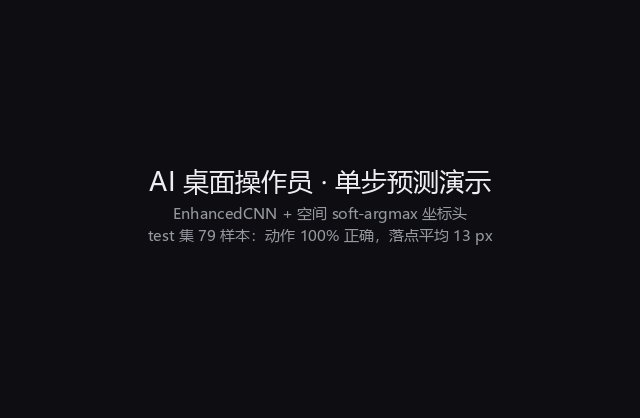
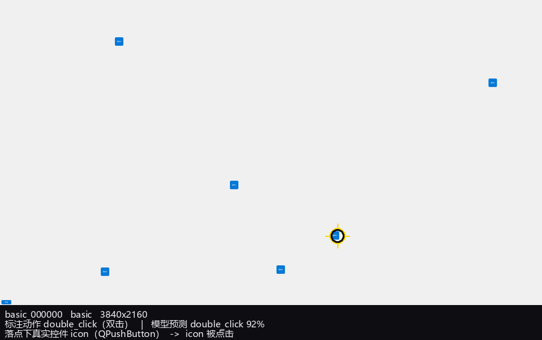
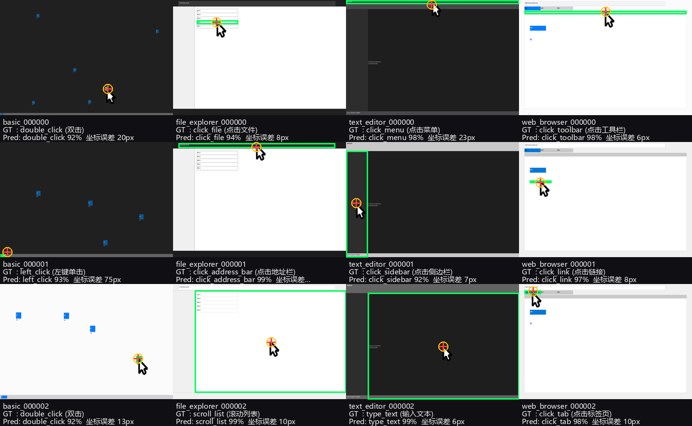

# AI智能桌面操作员

AI智能桌面操作员是一个基于深度学习和大语言模型的智能桌面自动化系统：用 DeepSeek 做自然语言任务理解，
用 CNN 分析屏幕内容并预测"该在哪、做什么操作"，再由自动化控制器执行鼠标/键盘动作。

---

## ⚠️ 请先处理：API 密钥已经泄露

`.env` 文件**曾被 git 跟踪**并推送到 GitHub（`origin/improve-training-and-automation`、`origin/backup-before-filter`，
涉及提交 `1f7f48d`）。其中的 `DEEPSEEK_API_KEY` 属于公开可读状态。

已完成的处理：

- ✅ `git rm --cached .env` —— 文件已移出版本控制，本地 `.env` 原样保留，`.gitignore` 持续生效
- ✅ 全历史扫描确认：**只有 `.env` 一个文件、只有 `1f7f48d` 一个提交**含该密钥，
  `config.py` 从未硬编码过密钥（它一直是 `os.getenv`）

**仍需你人工完成的两步：**

1. **到 <https://platform.deepseek.com> 吊销并轮换这个密钥。**
   这是唯一真正有效的补救——重写 git 历史**撤不回已经发生的泄露**
   （GitHub 的缓存、fork、以及任何克隆过仓库的人手里都还有旧密钥）。
2. **重写历史并强推**（可选，但建议做，防止旧密钥继续散播）：

   ```powershell
   pwsh scripts/purge_env_from_git_history.ps1            # 演练，只打印将执行的命令
   pwsh scripts/purge_env_from_git_history.ps1 -Execute   # 真正执行（自动打备份标签）
   ```

   脚本会剔除所有提交里的 `.env`、清理 `refs/original` 与 reflog、并再次扫描确认
   历史中已匹配不到 `sk-` 密钥。注意重写历史会改变所有提交 SHA，协作者需要重新 clone。

---

## 功能特性

- **智能任务理解**：使用 DeepSeek API 进行自然语言理解和任务分解
- **屏幕分析**：EnhancedCNN（ResNet50 主干 + 多任务头）分析屏幕内容，预测操作类型与点击坐标
- **空间定位**：soft-argmax 坐标头，在 test 集上平均误差 **20 px**（详见[实测结果](#实测结果)）
- **自动化操作**：支持鼠标点击、双击、右键、滚轮、键盘输入等自动化操作
- **工作流支持**：提供复杂任务的自动化工作流（如文档写作）
- **图形界面**：基于 PyQt6 的交互界面

## 项目结构

```
ai_operator/
├── core/                    # 配置
├── agents/                  # DeepSeek 智能体
├── data/
│   ├── data_processor.py
│   └── desktop_dataset.py   # ★ 数据集加载器（标注解析 / ImageNet 归一化 / 光标注入）
├── data_generation/         # ★ 数据集生成器
│   └── dataset_creator.py   #   已修复：空白截图 / 动作因果性 / 光标烘烤
├── models/
│   ├── cnn_model.py         # ★ EnhancedCNN：空间 soft-argmax 坐标头 + 多任务头
│   └── training_pipeline.py # 通用训练流水线（JSON 数据集）
├── automation/              # 鼠标 / 键盘 / Web / 工作流
├── ui/                      # PyQt6 界面
└── main.py                  # 主入口

scripts/
├── build_dataset_v2.py      # ★ 生成因果修正数据集 v2（推荐路径）
├── build_dataset_from_creator.py  # ★ 用已修复的生成器产出数据集 v3 + 因果性审计
├── train_ai_operator.py     # ★ 真正可用的训练脚本
├── demo_desktop_agent.py    # ★ 演示脚本（eval / image / live 三种模式）
├── make_demo_gif.py         # ★ 把预测结果做成演示 GIF
├── gui_agent_demo.py        # ★ 真实 GUI 操作演示（真实 Qt 控件 + 真实点击投递）
├── repair_screenshots.py    # ★ 修复 v1 数据集里的空白截图
├── purge_env_from_git_history.ps1  # ★ 从 git 历史中清除 .env
├── train_example.py         # 合成数据冒烟训练
├── infer_example.py         # 单张推理示例
└── export_onnx.py           # 导出 ONNX

tests/
├── test_desktop_pipeline.py # 数据集 / 模型 / 生成器回归测试
├── test_app_integration.py  # ★ 配置加载、统一推理入口、GUI 能否真正启动
└── test_gui_agent_demo.py   # ★ 真实 GUI 操作演示的命中测试与点击投递
```

> 根目录原本还有 8 个早期脚手架脚本（`prepare_dataset.py`、`model_evaluation.py`、
> `model_finetuning.py`、`enhanced_training.py`、`ai_operator_complete.py`、
> `desktop_automation_main.py`、`improved_desktop_automation.py`、`ai_operator_integration.py`）。
> 它们都基于已被替换的旧接口（`EnhancedCNN(14)`、把 `actions` 头当成 `[x, y, 12类概率]`），
> 引用的 checkpoint 也不存在，运行只会输出随机结果，**已全部删除**（git 历史中仍可找回）。

## 安装

```bash
.venv\Scripts\python.exe -m pip install -r requirements.txt
```

当前 `.venv` 内已装好 PyTorch 2.9.1（**CPU 版**）、torchvision、onnxruntime、PyQt6、scikit-learn 等。
ResNet50 的 ImageNet 预训练权重已缓存在 `~/.cache/torch/hub/checkpoints`，离线也能训练。

> 若想用本机的 RTX 3050 Ti 加速，可换成 CUDA 版 PyTorch：
> `pip install torch torchvision --index-url https://download.pytorch.org/whl/cu121`
> （约 2.5 GB 下载；CPU 版训练 349 张图约 50 秒/轮，其实已经够用。）

## 配置 API 密钥

三种方式，任选其一（**项目根目录的 `.env` 会被自动加载**）：

```powershell
# 方式一：项目根目录的 .env（推荐，已在 .gitignore 中）
#   .env 内容示例：  DEEPSEEK_API_KEY=sk-xxxxxxxx

# 方式二：当前会话
$env:DEEPSEEK_API_KEY = "your_api_key_here"

# 方式三：永久
setx DEEPSEEK_API_KEY "your_api_key_here"
```

优先级：**非空的环境变量 > `.env`**。若环境变量存在但为空（Windows 上
`$env:KEY=""` 会留下一个已定义的空变量），则视为未设置，继续回落到 `.env`。

> 密钥是**可选**的：没有密钥时 GUI 仍能正常启动，屏幕分析（本地模型）完全可用，
> 只有 DeepSeek 相关的"自然语言任务理解"会走兜底分支。界面上会明确标注状态。
>
> 不要把密钥写进代码或提交 `.env`（见文首警告）。

---

## 快速开始：训练 + 演示

项目里有**两代数据集**，推荐直接看 v2：

| | v1（`ai_operator_dataset/`） | **v2（`ai_operator_dataset_v2/`）** |
|---|---|---|
| 动作标签 | 与目标元素**独立随机**，无因果 | 由目标元素类型**唯一决定** |
| 光标 | 截图里没有，需运行时注入 | 已**烘烤**进截图 |
| 可达到的准确率 | 动作 ≈33%（天花板，见下文） | **动作 100%，坐标 20 px** |

### 路线 A（推荐）：用 v2 数据集，一次跑出好结果

```powershell
# 第 1 步 生成 v2 数据集（固定 seed，可重复；约 20 秒）
.venv\Scripts\python.exe scripts\build_dataset_v2.py --out ai_operator_dataset_v2 `
    --train 560 --val 120 --test 120

# 第 2 步 训练（必须加 --spatial-coord，见下文"空间坐标头"）
.venv\Scripts\python.exe scripts\train_ai_operator.py `
    --data-root ai_operator_dataset_v2 --out-dir models\desktop_v2 `
    --spatial-coord --epochs 16 --batch-size 16 --patience 5

# 第 3 步 演示评估
.venv\Scripts\python.exe scripts\demo_desktop_agent.py --mode eval --split test `
    --model models\desktop_v2\best_model.pth --label-map models\desktop_v2\label_map.json `
    --data-root ai_operator_dataset_v2 --grid 12 --report-dir reports\v2
```

> v2 截图里已经画好光标，**评估时不要加 `--draw-cursor`**（会重复画一个）。

### 路线 B：修复并使用 v1 数据集

```powershell
# 一次性修复 249 张纯色空白截图（只改图，不动标注，原图自动备份）
.venv\Scripts\python.exe scripts\repair_screenshots.py --dry-run
.venv\Scripts\python.exe scripts\repair_screenshots.py

# v1 截图里没有光标，需要运行时注入才谈得上坐标回归
.venv\Scripts\python.exe scripts\train_ai_operator.py --draw-cursor --spatial-coord `
    --epochs 20 --out-dir models\desktop_cursor_v1
.venv\Scripts\python.exe scripts\demo_desktop_agent.py --mode eval --split test `
    --model models\desktop_cursor_v1\best_model.pth --label-map models\desktop_cursor_v1\label_map.json `
    --draw-cursor
```

### 训练脚本做的事

| 项目 | 说明 |
|---|---|
| 标签 | 动作分类 = `operation.action`；坐标回归 = `operation.target_bounds` 中心点，按**每张图自己的宽高**归一化 |
| 预处理 | 缩放到 224×224 + **ImageNet 均值方差归一化**（与预训练 ResNet 对齐；旧的 `data_processor` 只做 `/255`，会浪费预训练权重） |
| 损失 | `CrossEntropy(label_smoothing=0.1) + 1.0 × SmoothL1(坐标头输出, 目标点)` |
| 优化 | AdamW，主干 `1e-4` / 预测头 `1e-3` 分组学习率 + CosineAnnealing，梯度裁剪 5.0 |
| 选优/早停 | 默认按验证准确率；`--monitor coord` 改为按坐标误差（见下） |
| 增强 | 亮度/对比度抖动；`--augment-shift N` 追加保标签的平移增强 |
| 加速 | 训练时跳过用不上的分割分支（省约一半算力）；截图预载进内存（`--draw-cursor` 在预载阶段画一次，训练循环零开销） |
| 产出 | `best_model.pth` / `last_model.pth` / `label_map.json` / `training_history.json` / `metrics.json` |

### 五个关键开关

- **`--spatial-coord`（重要）**：把坐标头从"全局池化 + 线性"换成 **soft-argmax 热力图**。
  旧结构下 `mouse_head` 收到的是被 ResNet `avgpool` 压成 `1×1` 的特征，
  **线性层不可能从全局描述子里恢复坐标**——实测坐标误差会卡在 200–300 px 下不去。
  打开后第 1 轮就降到 35 px。
- **`--monitor`**（`acc` / `coord`，默认 `acc`）：决定用哪个指标选最优模型、并据其早停。
  准确率会**饱和在 100%** 而坐标往往还在继续下降，按准确率早停会白丢精度。
  同一份 v3 数据、同一套超参、同样 12 轮：

  | 选优准则 | 验证坐标误差 | test 坐标误差 | 准确率 |
  |---|---|---|---|
  | `--monitor acc`（默认，向后兼容） | 26 px（第 3 轮即饱和） | 42 px | 100% |
  | **`--monitor coord`** | **8 px** | **13 px** | 100% |

  即"只换选优准则"就换来约 **3.2×** 的定位精度提升，准确率不变。关心定位时请用它。
- **`--augment-shift N`**：保标签的平移增强（图像移多少、目标点标签就移多少，边缘填充）。
  目标点贴边时会**放弃该次增强**而不是夹标签——否则图像移了、标签没跟上，等于掺错标。
  仅训练集生效，验证集绝不增强。实测结论见下文（**在本合成数据上并未带来收益**）。
- **`--draw-cursor`**：在目标点画箭头光标。只适用于截图里**没有**光标的 v1 数据集；
  v2/v3 的光标已烘烤进图片，再加会重复画。
- **`--data-root`**：数据集根目录，用于切换 v1 / v2 / v3。

> `metrics.json` 会同时记录两个准则各自的最优轮次（`best_acc_epoch` / `best_coord_epoch`）
> 以及实际被保存的那一轮（`selected_*`），便于判断"是否因选优准则而丢掉了精度"。
> 逐类统计也会先载回 `best_model.pth` 的权重再算，避免早停后"最后一轮"与"最优轮"
> 不是同一组权重导致报告自相矛盾。

### 数据集生成器本身的修复（`ProfessionalDatasetCreator`）

除了另起炉灶的 v2，**旧的生成器路径也已修好**，因为它同样在被直接使用：

| 修复 | 原问题 | 现在 |
|---|---|---|
| `create_app_interface()` | 调用 `create_*_interface()` 后**从不绘制**，三类应用截图全是纯色空白图 | 统一绘制；有回归测试 |
| `generate_app_specific_operation()` | 先随机选动作、再独立随机选元素，两者无关 | 动作由元素类型唯一决定（`resolve_action()`） |
| `generate_random_operation()` | 图标点击在 left/double/right 间随机 | 同上 |
| `save_sample()` | 截图里没有光标，坐标不可见 | 自动把光标画到目标元素中心 |

**修复前后的实测对比**（同一份标注统计，`scripts/build_dataset_from_creator.py` 自动审计）：

| | 已发货数据集 v1 | 修复后生成的 v3 |
|---|---|---|
| 目标元素类型数 | 9 | 12 |
| **存在动作歧义的元素类型** | **9 / 9（全部）** | **0 / 12** |
| 最严重的例子 | `toolbar` → 10 种不同动作 | 每个元素类型恰好 1 种动作 |

也就是说，v1 数据集里**每一个**元素类型的动作都是不确定的——这就是"动作准确率天花板"的来源。

> 注意 `button` 这个元素类型：曾经在浏览器里映射成 `click_button`、在桌面里映射成 `left_click`，
> 这会让"动作是元素类型的纯函数"只在给定应用时成立并碎片化标签空间。
> 审计脚本报出了这个假阳性，现已统一为 `left_click`。

生成 v3 与训练：

```powershell
.venv\Scripts\python.exe scripts\build_dataset_from_creator.py `
    --out ai_operator_dataset_v3 --train 300 --val 80 --test 80
.venv\Scripts\python.exe scripts\train_ai_operator.py `
    --data-root ai_operator_dataset_v3 --out-dir models\desktop_v3 `
    --spatial-coord --epochs 12 --patience 4
.venv\Scripts\python.exe scripts\demo_desktop_agent.py --mode eval --split test `
    --model models\desktop_v3\best_model.pth --label-map models\desktop_v3\label_map.json `
    --data-root ai_operator_dataset_v3 --report-dir reports\v3
```

### 演示

```powershell
# ① 批量评估：准确率、坐标误差、混淆分析、可视化拼图、逐样本 CSV
#    （同一目录下还有 demo_grid_test.png / demo_metrics_test.json）
.venv\Scripts\python.exe scripts\demo_desktop_agent.py --mode eval --split test --grid 12

# ② 任意一张截图做单次预测，并把结果画在图上
.venv\Scripts\python.exe scripts\demo_desktop_agent.py --mode image `
    --image ai_operator_dataset_v2\test\images\web_browser_000004\screenshot.png `
    --model models\desktop_v2\best_model.pth --label-map models\desktop_v2\label_map.json

# ③ 实时闭环：截屏 -> 预测 -> （可选）真的把鼠标点下去
.venv\Scripts\python.exe scripts\demo_desktop_agent.py --mode live --interval 2            # 空跑
.venv\Scripts\python.exe scripts\demo_desktop_agent.py --mode live --execute --rounds 3    # 真执行
```

`--mode eval` 会自动从 checkpoint 里识别坐标头类型（`coord_head.*` 是否存在），
所以不需要手动对齐训练/评估配置；它还会自动区分 v1/v2 数据集并打印相应的解释。

> `live` 模式默认**空跑**（只打印将要执行的动作），必须显式加 `--execute` 才会操作真实鼠标键盘。
> `--min-confidence` 用于过滤低置信度预测。
> 注意 `--mode live` 会把当时的屏幕内容存成 `reports/live_*.png`（已在 `.gitignore` 中忽略），
> 不需要的话直接删掉即可。

### 演示 GIF

```powershell
# 用 eval 产出的逐样本预测生成一张动图（默认输出 reports/demo.gif）
.venv\Scripts\python.exe scripts\make_demo_gif.py

# 调整尺寸 / 每应用样本数 / 放大倍数
.venv\Scripts\python.exe scripts\make_demo_gif.py --scale 560 --per-app 1 --zoom-divisor 2
```



**这张 GIF 是什么、不是什么**（画面上也标注了同样的说明）：

- 它**不是**"智能体自主完成任务"的录屏。当前模型是**单步、静态截图**预测器：
  输入一张截图，输出"该执行哪个动作 + 点哪里"。它没有时间维度、不会多步规划。
  圆环从画面中心飞向落点只是**视觉引导**，不是模型走出来的轨迹。
- 每张截图里的**白色箭头是数据集自带的光标**（位置=标注目标中心，即标准答案）；
  **黄圈才是模型预测的落点**，两者之差就是误差。
- 画面是**以目标为中心的 1/3 放大区域**，右上角小图给出全屏位置。
  不放大不行：4K 截图整屏缩到 640px 后，图标只有十几像素，根本看不清。

实现上有三个细节是踩坑之后才对的：

1. **不能整个屏幕直接缩放**：3840×2160 缩到 640 宽后光标与图标都糊成小块。
   改为按目标裁剪 1/N 再放大。注意面板里光标的视觉大小恒为 `42.9×N` 像素
   （与屏幕分辨率无关，因为光标本身按屏宽等比生成），所以 N 越大光标越夸张、
   越会遮住目标；`--zoom-divisor` 默认 3 是折中值。
2. **不要用 ✓/✗ 这类符号**：中文字体里没有对应字形，PIL 会渲染成豆腐块（□）。
   改用"动作正确/动作错误"汉字。已加测试固化。
3. **预测标记需要深色描边**：纯黄色圆环在浅色主题（240,240,240 背景）上对比度不足，
   先画粗深色再叠亮色，浅色/深色主题下都清晰。

另外 `optimize=True` 会**合并相邻完全相同的帧**并把时长累加（本例 50 帧存成 47 帧，
总时长仍为 16.7s），这是正常行为，不是丢帧。

### 第 3 步 图形界面 / 其他模式

```powershell
.venv\Scripts\python.exe -m ai_operator.main --mode gui    # PyQt6 界面
.venv\Scripts\python.exe -m ai_operator.main --mode test   # 自检
```

**图形界面**（现已接入训练成果）：

- 启动时自动扫描 `models/`，默认加载最佳模型；右侧"模型配置"下拉框可切换其他已训练模型，
  每项都带关键指标（如 `desktop_v3_coord（12类, 准确率100%, 坐标8px）`）。
- 点"捕获屏幕"→ 全分辨率截图 → 用已加载模型预测 → 结果显示**动作名 + 中文说明 + 置信度 +
  真实屏幕像素坐标 + Top-3 候选**（以前显示的是一串类别整数索引，无法判断模型预测了什么）。
- 没有可用模型时，界面会明确写出"未加载屏幕分析模型"并给出训练命令，
  而不是静默使用随机权重（那会让界面看起来在工作、实际全是噪声）。
- 没有 DeepSeek 密钥时界面照常启动，只在"模型配置"区标注状态。

**自检** `--mode test` 会逐项报告：配置路径、DeepSeek 密钥是否可用、屏幕分析模型
（名称/类别数/输入尺寸/坐标头类型/训练指标）、数据处理器。它不会因为缺少
密钥或模型而失败，而是如实说明缺什么。

### 真实 GUI 操作演示

```powershell
# 复现演示：模型预测 -> 在真实 Qt 窗口上真实点击 -> 检验控件响应
.venv\Scripts\python.exe scripts\gui_agent_demo.py --mode reproduce --count 16

# 朴素闭环：演示"只会点光标所在处"导致的退化
.venv\Scripts\python.exe scripts\gui_agent_demo.py --mode loop --steps 6

# 光标偏移实验：把光标画到不同位置，量化跟随程度
.venv\Scripts\python.exe scripts\gui_agent_demo.py --mode probe
```



这个演示**不接触你的真实屏幕，也不碰真实鼠标**：窗口在 Qt 离屏平台渲染，
点击通过 `QTest.mouseClick` 走 Qt 事件系统投递到具体控件。这比 OS 级鼠标注入
更适合演示——确定、可重复、不会劫持你的输入。

**先说清楚它演示的是什么**：不是"智能体自主操作桌面"，而是
**从演示中复现操作**（action reproduction）。原因见下面那条实验结论。

窗口是**真实 Qt 控件**，且几何取自**该样本自己的标注**（`elements[].bounds`），
窗口尺寸等于该样本的原始分辨率，因此"模型预测的落点"与"真实控件的位置"
在同一坐标系里。

实测结果（16 个样本，覆盖 4 个应用）：

| 指标 | 结果 | 含义 |
|---|---|---|
| 动作与标注一致 | **100%**（16/16） | 模型认对了演示的动作 |
| 落点与标注目标框距离 | 中位 **0px** / 平均 3.8px / 最大 38px | 定位精度 |
| 点击命中真实控件 | **88%**（14/16） | 落点下方确实有控件并收到点击 |
| **动作与落点控件自洽** | **81%**（13/16） | 它说的动作，是否与它自己指的位置下方的控件一致 |

交互响应明细（分开统计，避免把正常情况误判为失败）：
控件发信号 10 次、焦点转移 3 次、无可见变化 1 次（点已聚焦的控件）、
落点没有控件 2 次。

**两个脱靶都不是坐标系错误，而是小目标问题**：

| 样本 | 目标框尺寸 | 落点偏离目标框 | 占屏宽 |
|---|---|---|---|
| `basic_000001` | 70×30 | 38px | 1.49% |
| `basic_000003` | 60×60 | 15px | 0.59% |

桌面图标/按钮在 2560~3840 宽的截图里只有 30~70px，绝对误差一超过目标尺寸就脱靶。

唯一的"动作-落点不自洽"是 `text_editor_000000`：模型正确识别出 `click_menu`，
但落点下移约一个条带宽度，落到了紧邻的 `toolbar` 上（menu 是 y 0–30，
toolbar 是 y 30–70）。

#### ⚠️ 实测结论：这个模型不能自主推进任务

`--mode probe` 在**无烘烤光标**的干净窗口上把光标画到不同位置，看模型预测点如何变化：

| 光标画在 | 模型预测点 | 偏差 |
|---|---|---|
| (0.1, 0.1) | (436, 202) | 54px |
| (0.5, 0.5) | (1900, 1084) | 20px |
| (0.7, 0.7) | (2767, 1507) | 79px |
| (0.9, 0.9) | (3279, 1930) | 178px |

平均偏差 **70.9px ÷ 3840 宽 = 1.85%** —— 预测点基本就是光标所在处。

原因是训练数据里**光标就画在点击目标上**，于是模型学到的是"点光标所在处"，
而不是"根据界面内容决定该点哪里"。把这种模型放进朴素闭环
（截屏→预测→执行→再截屏），它会原地打转：

```text
  步        光标位置   预测动作      预测落点   位移px
  1    (1920, 1080)  scroll_page  (1900, 1084)   20.4
  2    (1900, 1084)  double_click (1909, 1078)   10.8
  3    (1909, 1078)  double_click (1907, 1078)    2.0
  4    (1907, 1078)  double_click (1910, 1076)    3.6
  5    (1910, 1076)  double_click (1903, 1078)    7.3
  6    (1903, 1078)  double_click (1912, 1076)    9.2
```

平均每步位移 **8.9px**，最终收敛到抖动 —— 任务零推进。

这不是调参能解决的问题，而是**任务定义缺失**：给定一张静态截图、且没有目标说明，
"该点哪里"在信息论上就不确定。要让模型成为智能体，必须补上二者之一：

1. **目标输入**（自然语言指令或任务状态），让"该点哪里"由目标决定；
2. **把光标位置作为显式输入**，让模型学"相对光标的偏移"而不是"光标的绝对位置"。

当前数据集两者都没有，所以本演示诚实地定位为**从演示中复现操作**。

> 搭建这个 demo 的过程中修掉了 4 个**属于 demo 自己**的 bug（都会让统计看起来是
> 模型问题、实际是坐标系或命中测试错误）：`childAt` 返回内部 viewport 导致
> 命中读成 `None`；v1 标注没有 `resolution` 字段导致窗口尺寸错误；
> "该元素在本应用下的规范动作"误用全局映射造成**假阴性**；
> `loop`/`probe` 用固定画布尺寸而非窗口实际尺寸。四者都已加回归测试，
> 并做过变异验证（把修复退回原状，对应用例确实失败）。

**写作工作流** `--mode workflow`：

```powershell
# 注意 PowerShell 会吞掉内层双引号，JSON 参数必须写成 '{\"k\": \"v\"}' 这种形式
.venv\Scripts\python.exe -m ai_operator.main --mode workflow `
    --topic "人工智能发展趋势" `
    --requirements '{\"length\": \"1000字\", \"tone\": \"专业\"}'
```

> 这条命令以前是**跑不通的**：`WritingWorkflow` 调用了
> `keyboard_controller.press_shortcut()` 与 `press_key()`，而控制器提供的
> 其实是 `hotkey(*keys)` 与 `press(key)`，一执行就 `AttributeError`（已修复，
> 并加了全仓库静态检查防止再犯）。README 原先给出的双引号写法在 PowerShell 下
> 也会被吞掉引号、导致 JSON 解析失败，上面是实测可用的写法。

> 一致性说明：GUI 与 `scripts/demo_desktop_agent.py` 现在共用
> `ai_operator/models/inference.py` 的 `ScreenPredictor`。已验证 GUI 的预测结果与
> 评估 CSV **逐样本完全一致**（79/79 动作相同、坐标偏差 0.00 px），
> 因此界面上看到的数字与 README 中的指标是同一套。

### 第 4 步 导出 ONNX（可选，部署用）

```powershell
.venv\Scripts\python.exe scripts\export_onnx.py `
    --checkpoint models\desktop_v3_coord\best_model.pth `
    --onnx-path models\desktop_v3_coord\best_model.onnx
.venv\Scripts\python.exe scripts\infer_example.py --use-onnx --onnx-path models\desktop_v3_coord\best_model.onnx
```

导出脚本会自动识别坐标头类型，并自动从权重推断动作类别数。
默认 opset 为 **18**：当前 torch 只内置了 opset 18 的实现，请求更低版本会触发 ONNX
的自动降级转换并打印 `axes_input_to_attribute` / `Failed to convert` 报错文本
（转换失败但模型保留在 18，导出结果仍可用）。用 18 就没有这些噪音。
目标运行时较老时可用 `--opset` 显式指定更低值，但请自行验证数值一致性。

已验证 ONNX 与 PyTorch 数值一致（8 张真实截图，坐标最大偏差 `5.4e-07`，
logits 最大偏差 `1.1e-06`，Top-1 全部一致）——该检查已固化为
`tests/test_desktop_pipeline.py::OnnxExportEquivalenceTest`。

`best_model.onnx` 会配套一个 100 MB+ 的 `best_model.onnx.data`（外置权重），两者都已加入 `.gitignore`。

---

## 实测结果

所有数字都在同一台机器（CPU，i7-11800H）、同一套评估协议下实测。
逐样本预测与可视化在 `reports/` 下的各子目录。

### 总览

> ⚠️ 下表的"test"列都是在**各自数据集上**跑出来的。最初的损坏数据集版本只跑到第 4 轮就被中止，
> 没有留下 test 结果，它的验证集数字单列在下一节。

| 配置 | 数据集 | 光标 | 坐标头 | 选优准则 | test 动作 Top-1 | test 坐标平均误差 |
|---|---|---|---|---|---|---|
| A | v1 修复后 | 无 | 全局池化 + 线性 | acc | 30.7% | 597 px |
| B | v1 修复后 | 运行时注入 | 全局池化 + 线性 | acc | 29.3% | 309 px |
| C | v2 因果 | 已烘烤 | 全局池化 + 线性 | acc | 57.5% ⚠️ | 360 px |
| D | v2 因果 | 已烘烤 | spatial soft-argmax | acc | **100.0%** | 20 px |
| E | v3（修复后的旧生成器） | 已烘烤 | spatial soft-argmax | acc | **100.0%** | 42 px |
| **F** | **v3** | **已烘烤** | **spatial soft-argmax** | **coord** | **100.0%** | **13 px** |

> ⚠️ 配置 C 只训练了 1 轮就被中止，动作准确率被严重低估，不能与 D 直接比动作。
> 但坐标误差 360 px vs 20 px 的差距与下面的架构分析一致。

参考基线：随机猜测 6.2%–8.3%，多数类 23.3%–45.6%。

### 可用模型

| | **F：v3 + coord 选优（当前最佳）** | **D：v2** | **E：v3 + acc 选优** |
|---|---|---|---|
| 数据来源 | `build_dataset_from_creator.py` | `build_dataset_v2.py` | `build_dataset_from_creator.py` |
| 训练/验证/测试 | 300 / 79 / 79 | 560 / 120 / 120 | 300 / 79 / 79 |
| 类别数 | 12 | 13 | 12 |
| 选优准则 | `--monitor coord` | `--monitor acc` | `--monitor acc` |
| 验证集动作 Top-1 | 100.0% | 100.0% | 100.0% |
| 验证集坐标误差 | **8 px** | 11 px | 26 px |
| test 动作 Top-1 / Top-3 | **100.0% / 100.0%** | 100.0% / 100.0% | 100.0% / 100.0% |
| test 坐标误差 | **平均 13 px / 中位 10 px** | 平均 20 px / 中位 15 px | 平均 42 px / 中位 27 px |
| 训练耗时（CPU） | 492 s | 1083 s | 282 s |
| 12–13 类是否全对 | 是 | 是 | 是 |

F 与 E 用的是**完全相同的数据、架构和超参**，唯一区别就是 `--monitor`：
E 在第 3 轮准确率触顶 100% 后就被早停，保存的权重坐标误差 26 px；
F 改按坐标选优，一路降到第 12 轮的 8 px。这是"继续优化"里性价比最高的一处改动。

ONNX 导出（opset 18）与 PyTorch 的一致性已用 8 张真实截图验证：
坐标最大偏差 `5.4e-07`、logits `1.1e-06`、Top-1 全部一致；该检查已固化为单测。

**泛化性**（按截图指纹拆分 test 集）：

| 数据集 | 分组 | 样本 | 动作 Top-1 | 坐标误差 |
|---|---|---|---|---|
| v2 | 见过该界面 | 55 | 100.0% | 16 px |
| v2 | **没见过该界面** | **65** | **100.0%** | **23 px** |
| v3（F） | 见过该界面 | 71 | 100.0% | 13 px |
| v3（F） | **没见过该界面** | **8** | **100.0%** | **9 px** |

在完全没见过的界面上依然 100% —— 模型学的是"光标压在什么元素上"这个规律，
而不是记住了某几张图。

### 一个**负结果**：平移增强没有帮上忙

`--augment-shift 12`（保标签平移增强）在同一份 v3 数据上做了 A/B，选优准则都是 `--monitor coord`：

| 配置 | 验证坐标误差 | test 坐标误差 | test（未见过的界面） |
|---|---|---|---|
| **无增强** | **8 px** | **13 px** | **9 px** |
| `--augment-shift 12` | 13 px | 21 px | 13 px |
| `--augment-shift 12`（修掉"夹标签"缺陷后） | 15 px | 23 px | 18 px |

**结论：在这个合成数据集上，平移增强让定位变差了**，因此默认关闭（`--augment-shift 0`）。
可能的原因：界面元素本就落在固定的布局槽位上，平移并没有带来"更多真实布局"，
反而破坏了"光标相对元素边框的位置"这个最有用的线索。

另外要说明：过程中发现并修掉了一个真实缺陷——增强原本会把目标点标签 **clamp 到 [0,1]**，
而图像内容是整体平移的，于是贴边样本出现"图移了、标签没跟上"的错标。
现已改为**放弃该次增强**（见 `test_no_shift_when_target_would_leave_frame`）。
但这个修正并没有把增强的收益扳正——即使没有错标，它在本数据上依然更差。
如实记录这个负结果，是为了避免后来者以为"没开增强是漏了优化"。



绿框是标注里的目标元素，红十字符是模型预测的点击点。预测点落在光标尖端上。

### 最初那版（40% 截图是纯色空白图）

该版本只训练到第 4 轮就因结论已明确而中止，验证集上一直在多数类附近抖动：

| 轮次 | 验证 Top-1 | 验证 Top-3 | 坐标误差 |
|---|---|---|---|
| 1 | 16.0% | 58.7% | 396 px |
| 2 | 29.3% | 58.7% | 382 px |
| 3 | 18.7% | 60.0% | 396 px |
| 4 | 24.0% | 57.3% | 388 px |

坐标误差完全不动（380–396 px），因为那 40% 的截图里根本没有任何可看的内容。

### 推荐模型

`models/desktop_v3_coord/best_model.pth`（配置 F）。逐项指标见上面的"可用模型"表：
12 个动作类别**全部 100%**，test 坐标平均 13 px，ONNX 导出后与 PyTorch 数值一致。

复现命令：

```powershell
.venv\Scripts\python.exe scripts\train_ai_operator.py `
    --data-root ai_operator_dataset_v3 --out-dir models\desktop_v3_coord `
    --spatial-coord --monitor coord --epochs 12 --batch-size 16
```

### 每个改动各自贡献了多少

**坐标误差的瓶颈是架构，不是光标。** 这一点有一个确定性证据（不是统计推断）：

ResNet 的 `forward` 末尾自带 `avgpool`，所以旧代码里 `mouse_head` 实际收到的是
`(N, 2048)` 的全局向量——空间维度早就被压成 `1×1` 了。**线性层不可能从全局描述子里
恢复出坐标。** 这可以用探针直接验证：

```text
resnet 输出给后续头      : (1, 2048)      <- 空间信息在这里已经没了
mouse_head 第 0 层实际收到: (1, 128)
```

`tests/test_desktop_pipeline.py::test_global_pooled_head_cannot_localise` 固化了这个断言。

| 改动 | 动作 Top-1 | 坐标误差 | 说明 |
|---|---|---|---|
| ① 修复 249 张空白截图 | 30.7%（test） | 597 px | 动作略高于多数类；坐标仍被"没有光标"限制 |
| ② 再注入光标（仅此一项变化） | 29.3%（test） | **309 px（-48%）** | 坐标确实改善，但动作毫无起色 |
| ③ 换 spatial soft-argmax 坐标头 | — | 第 1 轮即 **35 px** | **坐标可用性的决定因素** |
| ④ 换 v2/v3 因果数据 | **100.0%** | 20 / 42 px | **动作准确率的决定因素** |
| ⑤ 选优准则改按坐标（`--monitor coord`） | 100.0% | **13 px** | **不需要重新设计，只换准则就 3.2×** |
| ⑥ 平移增强 `--augment-shift` | 100.0% | 21–23 px ↑ | **负结果，默认关闭** |

①② 是在完全相同的数据、架构、超参下只切换 `--draw-cursor` 的受控对比，
所以 597→309 px 可以归因于光标本身；但它只走完了到可用坐标的一半路，
剩下的 309→20 px 全部来自 ③。

结论：**凭直觉猜原因很容易猜错。**"没有光标"看起来最像元凶，实际只贡献了 597→309；
动作准确率更是和光标无关——它的瓶颈在标签本身（② 让动作从 30.7% 微降到 29.3%，
因为光标反而给模型提供了新的、与动作无关的干扰线索）。

⑤ 与 ⑥ 也值得注意：**最省力的改动（换选优准则）收益最大，而看起来"更专业"的
数据增强反而有害**。两者都只有在实测之后才知道。

### 为什么 v1 的动作准确率只有 ~30%？那是数据集的天花板

不是模型没学会，而是标签本身不可预测，有三条硬证据：

1. **截图里没有点击位置的标记**。数据集只存静态截图，没有光标也没有高亮框，
   "用户点的是哪个图标/按钮"在画面上根本不可见。
2. **应用内的动作与界面元素独立随机**。`dataset_creator.py` 的
   `generate_app_specific_operation()` 先 `random.choice(possible_actions)` 选动作，
   再 `random.choice(relevant_elements)` 选目标元素，两者互不相关。
3. **混淆矩阵正是这个指纹**：`double_click → left_click` × 12、`right_click → left_click` × 9。

这个判断现在有了直接测量：对已发货的 v1 标注做因果性审计，
**9 个目标元素类型里 9 个都存在动作歧义**（`toolbar` 一个元素类型对应 10 种动作）。
修复后同样审计结果是 **0 / 12**。

v1 上模型能可靠学到的只有"当前是哪个应用的窗口"（100%）。
让动作由元素唯一决定、并把光标画到目标上之后，准确率才从 ~30% 跳到 100%。

### 一个需要注意的细节：模型选择用的是准确率

`best_model.pth` 是按**验证集准确率**保存的，不是按坐标误差。
所以 `models/desktop_v1_cursor` 那次训练里，最优轮（第 9 轮）的坐标误差是 159 px，
而最后一轮已经降到 105 px——但后者没有被保存。
v3 也一样：第 3 轮就达到 100% 准确率并保存，而第 7 轮的坐标误差已经降到 11 px。
如果你更关心定位精度，应该改 `train_ai_operator.py` 里的保存准则（例如按 `val_coord_mae` 选优）。

### 还剩下的限制

- 数据集仍是**合成 UI 截图**，只验证算法链路，不代表真实桌面表现。
- 动作集合只有 12–13 类，且都是"单步动作"；真实任务需要多步动作序列。
- 数据集仍**没有自然语言指令**，所以还不能算真正的 vision-language agent；
  若要往那个方向走，需要启用 `MultiModalTransformer` 并重做数据集。
- v2 与 v3 都只有 **4 种应用布局**，界面多样性远低于真实桌面。

#### ⚠️ 一个会影响真实部署的分布差异：光标位置

训练数据把光标画在**本次点击的目标**上，等价于假设"用户在点击前已经把光标移到了目标"。
但在真实桌面上，推理那一刻光标通常停在**上一次操作的位置**，并不在本次目标上。

后果：模型会倾向于预测"光标现在在哪"，而不是"应该点哪里"。
这也意味着**不能**在 live 推理时用 `--draw-cursor` 把光标画到标签位置——那是把答案喂进去。

这条推断已由 [真实 GUI 操作演示](#真实-gui-操作演示) 的实验**定量证实**：
光标跟随偏差仅占屏宽 1.85%，朴素闭环平均每步只移动 8.9px 并迅速收敛，
任务零推进。请以那一节为准（含三条改进路径）。

## 已知问题 / 后续计划

本次"项目完善"修掉的集成类缺陷（都已加回归测试）：

| 缺陷 | 后果 | 现在 |
|---|---|---|
| GUI 用 `EnhancedCNN(34)` 随机初始化、**从不加载权重** | 界面"在工作"，输出全是噪声；34 类与训练好的 12/13 类也对不上 | 自动扫描 `models/`，默认加载最佳模型，下拉框可切换 |
| GUI 把 OpenCV 的 **numpy 数组**直接喂给模型 | `TypeError: conv2d() received numpy.ndarray` | 统一由 `ScreenPredictor` 做预处理 |
| `predict()` 对坐标再套一次 `sigmoid`，并乘上模型输入尺寸(224) | 对空间坐标头模型，坐标被压向 0.5；"像素坐标"毫无意义 | 统一走 `decode_points`，返回真实屏幕像素 |
| 缺 API key 时 `DeepSeekAgent` 急切构造 client | **GUI 连窗口都打不开** | 惰性构造，界面正常启动并标注"未配置密钥" |
| 项目自带 `.env` 却**无任何代码读取** | 用户按直觉写 `.env` 无效 | 启动时自动加载；非空环境变量优先 |
| 8 个根目录旧脚本用已废弃接口 | 运行输出垃圾 | 已删除 |

仍待处理：

1. **`.env` 密钥必须人工吊销**（见文首；历史清理脚本已就绪）。
   另外自检发现该密钥对应账户**余额不足**（调用返回 `402 Insufficient Balance`），
   所以即使密钥有效，DeepSeek 相关功能也需要先充值。
2. `scripts/export_onnx.py` 的 opset 默认值已从 11 提到 18（原因见上文）。
   若显式传 `--opset 11`，会看到 `axes_input_to_attribute` / `Failed to convert` 报错文本，
   那是 ONNX 版本转换器的内部行为，**不影响导出结果**（模型会保留在 18）。
3. `dataset_creator.create_app_specific_dataset()` 的 `num_samples` 会被
   `basic/app` 的比例整除后取整，实际产出可能略少于请求数量（如请求 80 得到 79）。
   这不会影响训练，但如果你依赖精确样本数，请以生成清单里的实际数字为准。
4. **不要用 PowerShell 的 `Set-Content`/`Out-File` 直接改写仓库里的 UTF-8 文件**：
   Windows PowerShell 5.1 默认按 ANSI(GBK) 写出，会把中文全部变成乱码；而
   `-Encoding UTF8` 又会**写入 BOM**（本次重构时 demo 脚本就被加了 BOM，已清理）。
   需要改文件请用编辑器/`edit` 工具。
5. `--augment-shift` 平移增强在本合成数据集上是负收益，默认关闭。
   若要启用，请先用 `--monitor coord` 做 A/B 对比再决定。
6. `ai_operator/models/training_pipeline.py` 与 `ai_operator/main.py --mode train` 走的是
   早期"单个 JSON 数据集"的旧训练路径（不支持 `--spatial-coord`、不做数据增强）。
   真实训练请用 `scripts/train_ai_operator.py`；该模块保留是因为 `tests/test_training_pipeline.py`
   仍在覆盖它，且它对小规模 JSON 数据仍有参考价值。
7. 仓库里已不再跟踪 `__pycache__/*.pyc`，`.gitignore` 也已覆盖 `/models/`、
   `ai_operator_dataset_v2/v3/`、`reports/live_*.png`。

## 注意事项

- 桌面自动化会真实操作鼠标键盘，请在受控环境中使用；`live` 模式默认空跑，加 `--execute` 前请确认屏幕状态。
- 数据集是合成 UI 截图，只用于验证算法链路，不能代表真实桌面环境的表现。
- 训练建议在具备 GPU 的环境上进行更长时间的训练。
